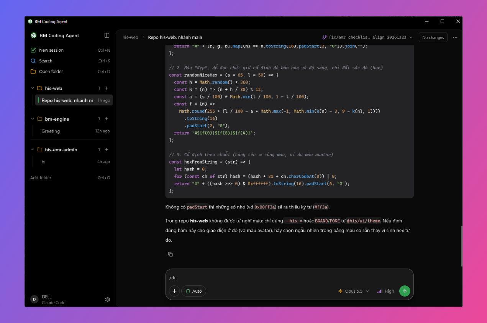

# BM Coding Agent

Ứng dụng desktop cho các coding agent, viết bằng Zig trên
[myzig](../../projects/myzig): giao diện native vẽ bằng GPU, không dùng
webview. Chạy được mọi agent hỗ trợ [ACP](https://agentclientprotocol.com):
Claude Code, Codex, Gemini CLI, OpenCode, pi hoặc agent của riêng bạn.



## Chạy thử

Cần Zig 0.17.0 và myzig tại `D:\projects\myzig`.

```sh
zig build run                          # mở ứng dụng
zig build run -- <thư-mục> -p "..."    # mở trên một thư mục, gửi prompt đầu
zig build test                         # chạy test
myzig build                            # bản release kèm icon và bộ cài
```

## Cài đặt

Chạy `BM Coding Agent Setup <version> x86_64.exe` (hoặc giải nén bản
portable). Bộ cài chưa ký số: SmartScreen hỏi thì chọn More info → Run anyway.
Máy cần có:

- Node.js, cho các agent chạy bằng `npx`
- CLI của agent đã đăng nhập một lần (bảng dưới)
- git, cho bảng thay đổi và khôi phục file theo lượt

## Agent

Cấu hình trong Settings → Agents. Mặc định:

| Agent | Lệnh | Đăng nhập bằng |
|---|---|---|
| Claude Code | `npx -y @agentclientprotocol/claude-agent-acp` | `claude` |
| Codex | `npx -y @agentclientprotocol/codex-acp` | `codex login` |
| Gemini CLI | `gemini --experimental-acp` | `gemini` |
| pi | `npx -y pi-acp` | `pi auth` |
| OpenCode | `opencode acp` | `opencode auth` |

Thử không cần tài khoản: thêm agent giả `node tools/mock-acp.mjs`.
`BM_AGENT_STATE=<file>` chạy với file state khác (mặc định
`%APPDATA%\bm-agent\state.json`).

## Tính năng

- Sidebar thư mục và session, trang Home, tab History đọc lại session cũ
  của agent (kể cả từ CLI)
- Câu trả lời Markdown stream trực tiếp, code tô màu, work log, kế hoạch,
  subagent
- Phê duyệt có diff xem trước; Retry, Edit, Copy cho từng prompt
- Composer: `@` chọn file, `/` skill và lệnh, hàng đợi prompt; đính kèm
  nhiều file bằng nút +, kéo thả từ Explorer hoặc Ctrl+V file đã copy (ảnh
  gửi kèm, file khác gửi dạng `resource_link` để agent tự đọc)
- Chọn model, chế độ phân quyền, mức suy nghĩ, context đã dùng
- Chuyển nhánh git; bảng thay đổi (diff, stage, discard) và khôi phục file
  theo lượt
- Command palette (Ctrl+K), chia đôi màn hình, lưu trữ và xóa session
- Settings → Storage: dọn session cũ của Claude Code, Codex, OpenCode
- Giao diện sáng/tối, màu nhấn, cỡ chữ; MCP server, skill, mức sử dụng

## Cấu trúc

| Thư mục | Nội dung |
|---|---|
| `src/acp/` | Tiến trình agent, JSON-RPC, giao thức ACP |
| `src/model/` | Transcript của session, đọc tool call |
| `src/host/` | git, state, skill, bộ chọn file, tác vụ nền |
| `src/app/` | `App`: agent, session, lượt, bản nháp |
| `src/views/` | Giao diện: sidebar, home, transcript, composer, settings… |
| `src/design/` | Design token, control dùng chung, icon ([Lucide](https://lucide.dev)) |
